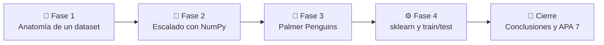

<div align="center">

# 🐍 Práctica N.º 2 · Preprocesamiento de Datos

### Anatomía de un dataset y escalado: Min-Max, Z-Score y Robust Scaler

[](https://colab.research.google.com/github/xErnyx/Practica_2_Preprocesamiento_de_Datos/blob/main/Practica_2_Preprocesamiento_de_Datos.ipynb)


**4 fases · 25 preguntas resueltas · explicadas paso a paso**

</div>

---

## 👤 Datos académicos

| | |
|---|---|
| 🎓 **Estudiante** | Juan D. Figueroa |
| 🏫 **Universidad** | Universidad Salesiana del Ecuador · Sede Sur |
| 📚 **Carrera** | Ciencias de la Computación |
| 🤖 **Asignatura** | Inteligencia Artificial · 6.º nivel |
| 👨‍🏫 **Docente** | Ing. Rodrigo Tufiño |
| 📅 **Fecha** | 17 Octubre de 2026 |

---

## 📖 ¿De qué trata este proyecto?

Antes de entrenar un modelo hay que entender los datos y prepararlos. Esta práctica recorre esa etapa con un dataset pequeño de estudiantes y con un dataset real, **Palmer Penguins**. Cada fase combina:

- 📐 **Teoría:** fundamento conceptual de cada técnica.
- ✏️ **Práctica:** código comentado con salidas visibles, implementado primero a mano con NumPy y luego con scikit-learn.
- 💬 **Análisis:** respuesta argumentada a cada pregunta de la guía.
- ✅ **Cierre:** introducción, objetivos, conclusiones, recomendaciones y referencias en **APA 7.ª edición**.

> [!TIP]
> Haz clic en el botón **Open in Colab** de arriba para ejecutar el notebook directamente en tu navegador. No necesitas instalar nada.

---

## 🗺️ Ruta de aprendizaje



---

## 🧩 Contenido por fases

### 🧬 Fase 1 · Anatomía de un dataset

Identificación de instancias, atributos, features y label en un dataset de 6 estudiantes.

| Actividad | Qué se resolvió | Concepto clave |
|:---:|---|---|
| 1.1 | **6 instancias** y 9 atributos; label `aprobado`; `nombre` descartado como feature | Instancia, feature, label |
| 1.2 | Tabla de clasificación de variables (`nivel_ingles` ordinal, `beca` nominal) | Cuantitativa/cualitativa, discreta/continua, nominal/ordinal |
| 1.3 | `dtypes` y `describe()` frente a la clasificación teórica | Tipo técnico vs. tipo conceptual |

### 🧮 Fase 2 · Escalado con NumPy

Min-Max y Z-Score implementados desde cero, con gráficos y un outlier simulado.

| Actividad | Qué se resolvió | Concepto clave |
|:---:|---|---|
| 2.1 | Matriz `(6, 3)` con las features continuas | `.values`, `astype(float)` |
| 2.2 | `min_max_manual`: cada columna queda en **[0, 1]** | Normalización Min-Max |
| 2.3 | `zscore_manual`: media ≈ 0 y desviación = 1; Carlos queda a **2.10** desviaciones en `distancia_km` | Estandarización Z-Score |
| 2.4 | Gráficas Original vs. Min-Max vs. Z-Score: la forma se conserva | Transformación lineal |
| 2.5 | Outlier de 120 km: Carlos baja de **1.0000 a 0.3305** en Min-Max | Sensibilidad a outliers |

### 🐧 Fase 3 · Dataset real: Palmer Penguins

| Actividad | Qué se resolvió | Concepto clave |
|:---:|---|---|
| 3.1 | **344 instancias**; nulos en 4 features numéricas (2 c/u) y en `sex` (11) | Exploración inicial |
| 3.2 | Clasificación de variables (`island` y `sex` nominales) | Tipos de variables |
| 3.3 | `dropna()`: 344 → **333 filas**; `body_mass_g` aporta ≈ **99.97 %** de la variación | Diferencias de escala |
| 3.4 | Histogramas idénticos antes y después de escalar (asimetría ≈ 0.47) | Escalar no normaliza |

### ⚙️ Fase 4 · scikit-learn: MinMax, Standard y Robust

| Actividad | Qué se resolvió | Concepto clave |
|:---:|---|---|
| 4.1 | Rango mayor `body_mass_g` (3600) y menor `bill_depth_mm` (8.4): **429 veces** | Comparación de escalas |
| 4.2 | División 80/20: **266 train** y **67 test** con `random_state=42` | `train_test_split`, data leakage |
| 4.3 | `fit_transform` en train y `transform` en test con los tres scalers | Patrón fit / transform |
| 4.3 | Verificación manual: mediana **4050 g** e IQR **1250 g** coinciden con `RobustScaler` | Mediana e IQR |

---

## 💡 Conceptos clave que se aprendieron

<details>
<summary><b>📏 Min-Max vs. Z-Score vs. Robust</b> (clic para expandir)</summary>

<br>

| Técnica | Fórmula | Rango | Sensible a outliers |
|---|---|---|---|
| **Min-Max** | `(x - min) / (max - min)` | [0, 1] | ✅ Mucho |
| **Z-Score** | `(x - media) / std` | Sin límite fijo | ⚠️ Moderado |
| **Robust** | `(x - mediana) / IQR` | Sin límite fijo | ❌ Poco |

```python
X_norm = (X - X.min(axis=0)) / (X.max(axis=0) - X.min(axis=0))   # Min-Max a mano
X_z    = (X - X.mean(axis=0)) / X.std(axis=0)                    # Z-Score a mano
```

</details>

<details>
<summary><b>🚨 Efecto de un outlier</b> (clic para expandir)</summary>

<br>

Min-Max depende solo del mínimo y del máximo. Al agregar un estudiante a 120 km, los demás se comprimen: Carlos pasa de 1.0000 a 0.3305. Con solo 6 datos, Z-Score también se ve afectado. El **RobustScaler**, basado en la mediana y el IQR, es la opción pensada para datos con valores extremos.

</details>

<details>
<summary><b>🔒 Data leakage: dividir antes de escalar</b> (clic para expandir)</summary>

<br>

Si el scaler se ajusta con todo el dataset, el test influye en los parámetros del entrenamiento. La regla correcta es aprender los parámetros solo con el train y aplicarlos al test sin recalcularlos.

```python
X_train, X_test = train_test_split(X, test_size=0.2, random_state=42)

scaler = StandardScaler()
X_train_zs = scaler.fit_transform(X_train)   # aprende y transforma
X_test_zs  = scaler.transform(X_test)        # solo transforma
```

</details>

<details>
<summary><b>📈 Escalar no vuelve normales los datos</b> (clic para expandir)</summary>

<br>

El escalado es una transformación lineal: cambia la escala del eje, pero no la forma de la distribución. En `body_mass_g` el histograma y la asimetría fueron los mismos antes y después de escalar.

</details>

---

## 🚀 Cómo ejecutarlo

**Opción 1 · En Google Colab (recomendada)**
1. Haz clic en el botón **Open in Colab** al inicio de este README.
2. Ejecuta todo con **Entorno de ejecución → Ejecutar todas**.
3. El dataset se descarga solo desde Hugging Face, por lo que se necesita conexión a internet.

**Opción 2 · En local**

```bash
git clone https://github.com/xErnyx/Practica_2_Preprocesamiento_de_Datos.git
cd Practica_2_Preprocesamiento_de_Datos
pip install numpy pandas scikit-learn matplotlib scipy jupyter
jupyter notebook Practica_2_Preprocesamiento_de_Datos.ipynb
```

---

## 📂 Estructura del repositorio

```text
📦 Practica_2_Preprocesamiento_de_Datos
 ┣ 📓 Practica_2_Preprocesamiento_de_Datos.ipynb   ← notebook con fases y respuestas
 ┣ 📄 README.md                                    ← descripción del proyecto
 ┗ 📄 LICENSE                                      ← licencia MIT
```

---

## 🛠️ Tecnologías

| Herramienta | Uso |
|---|---|
| **Python 3** | Lenguaje de programación |
| **NumPy** | Implementación manual de Min-Max y Z-Score |
| **pandas** | Manejo de DataFrames y exploración de datos |
| **scikit-learn** | `MinMaxScaler`, `StandardScaler`, `RobustScaler` y `train_test_split` |
| **Matplotlib / SciPy** | Gráficas y asimetría de las distribuciones |
| **Google Colab** | Entorno de ejecución en la nube |

---

## 📚 Referencias

- scikit-learn developers. (2024). *Preprocessing data — scikit-learn 1.4 documentation*. https://scikit-learn.org/stable/modules/preprocessing.html
- SIH. (2024). *Palmer penguins* [Conjunto de datos]. Hugging Face. https://huggingface.co/datasets/SIH/palmer-penguins
- Tufiño, R. (2026). *Guía de práctica de laboratorio N.° 01: Preprocesamiento de datos* [Material de clase, Inteligencia Artificial]. Universidad Salesiana del Ecuador - Sede sur.

---

<div align="center">

Hecho con 💙 por **Juan D. Figueroa** · [@xErnyx](https://github.com/xErnyx)

⭐ Si te sirvió este repositorio, ¡déjale una estrella!

</div>
